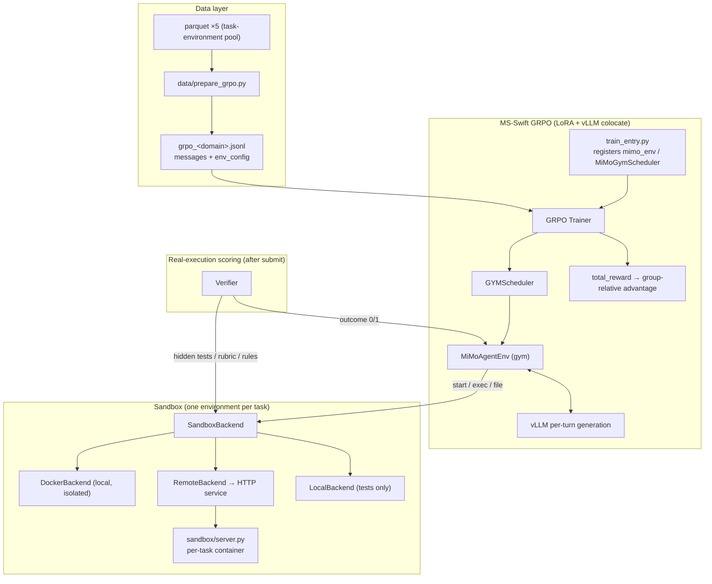
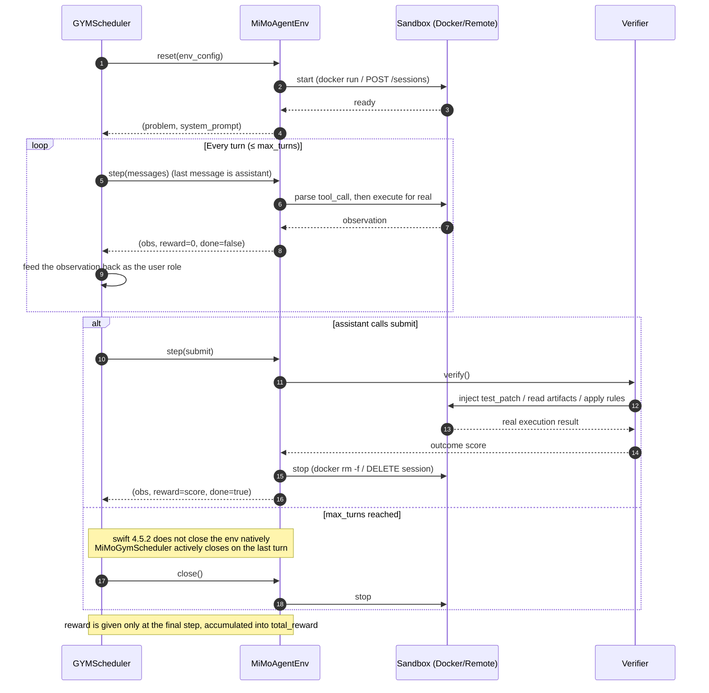
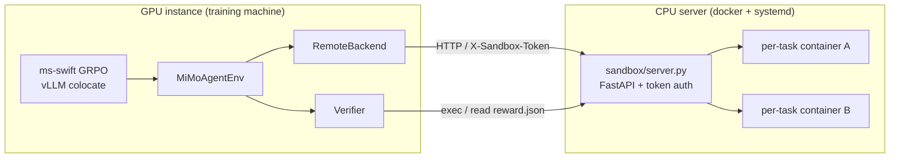

<h1 align="center">MiMo Agent GRPO on MS-Swift</h1>

<p align="center">
  <sub>MULTI-TURN TOOL USE&nbsp;·&nbsp;EXTERNAL SANDBOXES&nbsp;·&nbsp;REAL-EXECUTION VERIFIER&nbsp;·&nbsp;GRPO</sub>
</p>

<p align="center">
  <a href="https://github.com/modelscope/ms-swift"></a>
  <a href="https://huggingface.co/datasets/XiaomiMiMo/MiMo-V2.6-RL-oss"></a>
  <a href="LICENSE"></a>
  <a href="https://github.com/jerry1993-tech/mimo-agent-grpo-swift/stargazers"></a>
</p>

<p align="center">
  <b>English</b>&nbsp;&nbsp;·&nbsp;&nbsp;<a href="README_zh.md">简体中文</a>
</p>

Reproduce Xiaomi **MiMo-V2.6**'s open-source interactive Agent RL training pipeline with **MS-Swift** GRPO:
**multi-turn tool calling + external sandboxes + a real-execution verifier**, with the algorithm and
hyperparameters aligned item by item with the
[XiaomiMiMo/verl `mimo-oss`](https://github.com/XiaomiMiMo/verl) branch.

| Resource | Link |
|---|---|
| Training framework | [modelscope/ms-swift](https://github.com/modelscope/ms-swift) (**v4.5.2**, verified) |
| Training data | [XiaomiMiMo/MiMo-V2.6-RL-oss](https://huggingface.co/datasets/XiaomiMiMo/MiMo-V2.6-RL-oss) (Apache-2.0) |
| Starting model | [MiMo-V2.6-Distill-Qwen-9B](https://huggingface.co/XiaomiMiMo/MiMo-V2.6-Distill-Qwen-9B) |
| Task images | `xiaomimimo/mimo-v2.6-rl-oss` (Docker Hub, multiple tags in one repository) |
| Native pipeline | [XiaomiMiMo/verl](https://github.com/XiaomiMiMo/verl/tree/mimo-oss) · [mimoagent](https://github.com/XiaomiMiMo/mimoagent) |

---

## 0. Key facts

1. **What Xiaomi open-sourced is a "task environment pool", not data with trajectories.** The 5 parquet files hold **7,780 tasks** in only ~20MB; trajectories are **produced dynamically at training time** by the agent's multi-turn tool calls inside containers. The repository size comes mainly from 40k+ environment files.
2. **Xiaomi open-sourced only stage-2 RL (GRPO), not IL/SFT.** RL starts directly from the distilled weights. This project additionally provides an optional, equivalent IL path — "successful trajectories → SFT" (`data/collect_il_demo.py` + `data/prepare_sft.py`).
3. **The sandbox is one container per task.** Commands run through `docker exec` (equivalent to `timeout N bash -lc`), files are transferred via tar, and the container is destroyed after use; the image is specified by the data's `docker_image`. This project supports both local Docker and an **external HTTP sandbox service** (GPU instance + remote CPU server).

| Domain | Tasks | Verifier | Sandbox form |
|---|---|---|---|
| Code (SWE) | 2,698 | Hidden tests, exit 0 → 1.0 | Per-task image (2–12GB each) |
| WebDev | 2,093 | Deterministic checks + visual scoring hook | 1 shared image |
| General | 989 | Official `run_verify.py` (rubric/judge) | Shared image + MCP tools |
| Cyber (ARVO) | 1,000 | Sanitizer crash rule, binary | Per-task image |
| Music | 1,000 | ABC notation rule score | **No sandbox** |

---

## 1. Architecture and workflow

### 1.1 Architecture overview



### 1.2 Single-trajectory timeline (same as Xiaomi)



**Multi-turn mechanics**: generation does not continue from a persistent KV cache. Each turn feeds the previous turn's assistant(tool_call) and the tool observation back into `messages` and re-prefills to generate. Intermediate steps receive reward=0; only after the final `submit` does the verifier return the outcome in one shot (accumulated into `total_reward`).

**Tool protocol**: the MiMo distilled model natively emits the Qwen XML format
(`<tool_call><function=bash><parameter=command>…</parameter></function></tool_call>`);
`swift_agent/tool_parser.py` accepts both this format and JSON.

---

## 2. Alignment with Xiaomi VERL

### 2.1 Production MixRL vs. the open-source release recipe

- **Xiaomi's production training uses MixRL.** Paper §5.1 / §6.2–6.3 show that multiple data sources enter the same prompt batch in fixed proportions (coding 68%, general tool use 12%, aesthetic design 13%, context following 3%, cybersecurity 4%; 1568 prompts × 16 rollouts = 25,088 trajectories/step). The `dynsam/*` metrics in the production log `https://mimo.xiaomi.com/rl/mimo-v26` show code / visual / general / chat / cyber all contributing samples at every step. Each source's share is maintained by a **Sample Mixer** (adaptive concurrency, deficit-corrected scheduling, predictive dispatch, sample replay); the Sample Mixer is production infrastructure and **was not released with the open-source repository**.
- **Xiaomi's open-source release provides domain-level baselines.** The recipes/scripts in verl `mimo-oss` (paper §7.2) train Code / Cyber / General / Visual / Music independently by domain; the open-source repository contains no Sample Mixer / Data Scheduler code; the only mixing in the open-source repository is the mixture of 4 harnesses within the Code domain (`config/agent/code/mix-four-whitebox.yaml`).
- **This project reproduces the open-source release recipe.** This project's per-domain configs (code / music / general) correspond to the domain-level baselines of paper §7.2, not to the production MixRL system of paper §5–6.

### 2.2 Alignment of this project with the open-source recipe

The table below compares Xiaomi's open-source recipe (verl `mimo-oss`) with this project; the production MixRL Sample Mixer is out of scope.

| Component | Xiaomi open-source recipe `mimo-oss` | This project | Status |
|---|---|---|---|
| Algorithm / advantage | `adv_estimator=grpo`, subtract the group mean without dividing by std | `grpo` + `scale_rewards: none` | ✅ |
| KL / clip | No KL; clip 0.2 | `beta: 0.0`; `epsilon: 0.2` | ✅ |
| Sampling | temp 1.0 / top_p 0.95 / top_k 20 | Same | ✅ |
| Learning rate | 1e-6 constant | Same | ✅ |
| Group filtering | `filter_groups` drops whole groups | All-identical rewards → advantage 0 (equivalent to zero gradient) | ✅ Equivalent |
| Sandbox | One Pod per task, exec + tar | One container per task, exec + tar; remote HTTP service supported | ✅ |
| Images | Per-task image | `image-mapping.jsonl` maps official tags; automatic pull when missing | ✅ |
| Scoring | Real execution at the end of the stage | Verifier executes for real after `submit` (no tests during the agent phase) | ✅ |
| Reward placement | Single outcome at the final position | 0 for intermediate steps + outcome at the final step | ✅ |
| Infrastructure failure | `is_infra` is not scored 0 | `is_infra=True` (removed from the group) | ✅ |
| General | Dual containers (main + sidecar) + MCP | Single-container approximation + official verify preferred | ✅ Approximate |
| Music / WebDev | 18 features / group-level visual ranking | Rule subset / deterministic checks + hook | ⚠️ Partial |
| Training mode | Full-parameter + Megatron/SGLang | **LoRA** + vLLM colocate | 🔁 Equivalent substitution |

---

## 3. Project structure

```
mimo-agent-grpo-swift/
├── configs/                    # grpo_code / grpo_music / grpo_general / grpo_code_smoke / sft (yaml)
├── data/
│   ├── download_dataset.py     # download the 5 parquet files (ModelScope by default, HF optional)
│   ├── image_mapping.py        # dataset_image -> dockerhub tag mapping (image-mapping.jsonl)
│   ├── download_general_envs.py # download general/envs/<task>/ task environment dirs (925)
│   ├── prepare_grpo.py         # parquet -> GRPO jsonl (messages + env_config)
│   ├── gen_image_list.py       # grpo jsonl -> image pre-pull list
│   ├── prepare_sft.py          # rollout dump -> SFT jsonl (keep successful trajectories)
│   └── collect_il_demo.py      # optional: run the agent to collect successful trajectories
├── sandbox/
│   ├── base.py                 # SandboxBackend abstraction + ExecResult + backend factory
│   ├── docker_backend.py       # one container per task (default), image resolution / auto-pull / task-level resources
│   ├── local_backend.py        # temporary directory (no isolation, tests only), simulated container path mapping
│   ├── remote_backend.py       # HTTP client (auth / long timeouts / upload_dir)
│   ├── server.py               # external HTTP sandbox service (FastAPI, token / concurrency gate / idle reclamation)
│   ├── general_env_setup.py    # general-domain env_task_dir assembly (manifest uploads / MCP / rubrics)
│   ├── mcp_client.py           # general-domain MCP tool client
│   └── Dockerfile / docker-compose.yml / docker-entrypoint.sh
├── verifier/
│   ├── base.py                 # Verifier abstraction + VerificationResult
│   ├── code_verifier.py        # binary hidden tests (reset -> git apply -> test_command)
│   ├── cyber_verifier.py       # sanitizer crash rules
│   ├── general_verifier.py     # official run_verify.py preferred + LLM rubric fallback
│   ├── webdev_verifier.py      # rendering / visual (with grader hook)
│   ├── music_verifier.py       # ABC notation rules
│   └── llm_judge.py            # OpenAI-compatible judge
├── swift_agent/
│   ├── spec.py                 # TaskSpec (parquet/env_config conversion)
│   ├── tool_parser.py          # Qwen XML + JSON dual-format tool protocol + system prompt
│   ├── turn_executor.py        # single-turn tool execution + finalize
│   ├── agent_runner.py         # standalone episode (IL collection / smoke)
│   ├── mimo_env.py             # gym Env + MiMoGymScheduler (registers mimo_env) ★ training integration
│   └── train_entry.py          # training entry point (register env -> rlhf_main)
├── scripts/                    # prepare_data / deploy_sandbox_server / prefetch_images /
│                               # run_grpo / run_sft / start_sandbox / smoke_test
├── tests/                      # 41 tests (end-to-end loop + component unit tests + mock samples)
├── docs/INTERFACE.md           # frozen interface specification
├── .env.example                # sample environment variables (must be sourced manually)
├── requirements.txt
├── LICENSE                      # Apache-2.0
├── README.md                    # English (default on GitHub)
└── README_zh.md                 # Simplified Chinese
```

---

## 4. Installation

Requirements: Python ≥ 3.10; GPU training needs a CUDA version compatible with vLLM; the sandbox server needs docker.

```bash
conda create -n mimo-grpo python=3.11 -y && conda activate mimo-grpo

# Install torch / vllm for your local CUDA version (example: cu130)
pip install torch --index-url https://download.pytorch.org/whl/cu130
pip install vllm
pip install -r requirements.txt          # ms-swift>=4.5.2, etc.

python -c "import swift; print(swift.__version__)"   # should be >= 4.5.2
```

Environment variables: run `cp .env.example .env` and fill it in as needed. **`.env` is not loaded automatically**; inject it before use:

```bash
set -a; source .env; set +a
```

> If your GPU is Blackwell (sm120), `run_grpo.sh` / `run_sft.sh` already include
> `VLLM_USE_FLASHINFER_SAMPLER=0` (a workaround for flashinfer 0.6.12 having no sm120 cubin);
> when launching directly with `python swift_agent/train_entry.py`, export it yourself.

---

## 5. Model and data preparation

### 5.1 Download the model (ModelScope recommended in China)

```bash
pip install modelscope                     # usually already available in the ms-swift environment
modelscope download --model XiaomiMiMo/MiMo-V2.6-Distill-Qwen-9B \
    --local_dir /root/autodl-tmp/models/MiMo-V2.6-Distill-Qwen-9B
```

HF alternative: `export HF_ENDPOINT=https://hf-mirror.com && huggingface-cli download XiaomiMiMo/MiMo-V2.6-Distill-Qwen-9B --local-dir <same as above>` (slower).

**Update the model path in the configs**: the `model:` field in every `configs/*.yaml` currently points to
`/root/autodl-tmp/models/MiMo-V2.6-Distill-Qwen-9B`; if that does not match your actual path, replace it in bulk:

```bash
sed -i 's#^model: .*#model: /your/path/MiMo-V2.6-Distill-Qwen-9B#' configs/*.yaml
```

### 5.2 Download data and image mapping

```bash
# One-shot (all domains, docker backend by default)
bash scripts/prepare_data.sh
#   Reads env vars: SANDBOX_BACKEND (docker|remote|local), SANDBOX_URL,
#   JUDGE_BASE_URL / JUDGE_MODEL. For example, with a remote sandbox:
#   SANDBOX_BACKEND=remote SANDBOX_URL=http://<IP>:8100 bash scripts/prepare_data.sh code

# Or step by step
python -m data.download_dataset --domains code music     # ModelScope direct links by default
python -m data.download_dataset --channel hf --domains code   # switch to HF/HF-mirror
python -m data.image_mapping                             # image-mapping.jsonl (3764 entries)
python -m data.prepare_grpo --domains code music --limit 20 \
    --backend docker --output-path data/outputs/grpo_train.jsonl
```

- `--limit N`: randomly sample N tasks per domain (`--seed` controls the selection); useful for getting the pipeline working before scaling up.
- `--backend docker|remote|local` is written into each row's `env_config`; for remote deployment use `--backend remote --sandbox-url http://<IP>:8100`.
- Output: `data/outputs/grpo_<domain>.jsonl` (with `messages` and the full `env_config`).
- Merged file: `data/outputs/grpo_train.jsonl` is a static concatenation of the per-domain jsonl files. Each row's `env_config.domain` still routes it to the matching verifier and sandbox backend, so a training config pointing at the merged file is technically runnable. However, this project does not implement the production Sample Mixer (target source proportions, accept-rate/duration statistics, adaptive concurrency and replay). Paper §6.3 measured a 66× spread in rollout duration and a 90× spread in generated tokens between data sources; without the scheduler, slow sources hold up the whole batch and significantly degrade throughput and stability. This project trains per domain by default; the merged file is intended only for data inspection or custom experiments.
- Download channel: `MS_CHANNEL=modelscope|hf` (default modelscope).

**Image mapping (critical)**: the parquet `docker_image` is a local alias
(e.g. `format-code-task-001457:latest`), while the real image is
`docker.io/xiaomimimo/mimo-v2.6-rl-oss:format-code-task-001457` (**the tag name differs**).
`prepare_grpo` writes `env_config.dockerhub_image` from the mapping table; at runtime it is
preferred and pulled automatically when missing.

**general domain** additionally needs the task environment directories (rubric / MCP tools / workspace files):

```bash
python -m data.download_general_envs                       # all 925 (large)
python -m data.download_general_envs \
    --from-jsonl data/outputs/grpo_general.jsonl --limit 50 # sampled tasks only
python -m data.download_general_envs --tasks s3k_0000_accounting_audit_tax_en_t1_rl_008
```

Rows whose `env_task_dir` has not been downloaded are skipped by `prepare_grpo`, which prints statistics.

---

## 6. Sandbox

### 6.1 Local Docker

The training process directly `docker run`s a container per task (`--rm`, `--network=none` by default,
`--memory/--cpus/--pids-limit`, in-container TTL self-destruct); no long-running service is needed.

```bash
docker version    # confirm the daemon is available
```

Images are pulled automatically when missing locally (`SANDBOX_DOCKER_PULL_TIMEOUT`, default 1800s;
retries on interrupted streams via `SANDBOX_DOCKER_PULL_RETRIES=2`). The `cpus/memory_mb` values carried
by general-domain parquet override the default container resources.

### 6.2 External HTTP sandbox (GPU instance + remote CPU server) ★ Recommended

Suitable for GPU instances such as AutoDL that **cannot use docker-in-docker**: the GPU side runs only
training and vLLM generation, while all containers execute in docker on the remote server, and the two
communicate over HTTP.



> Every tool call, image pull, container execution and final scoring goes over HTTP to the server side;
> the GPU side never touches docker.

**Server side** (docker installed, clone this project):

```bash
bash scripts/deploy_sandbox_server.sh
# Automatically: lightweight venv (no torch) -> /etc/mimo-sandbox.env (random token) ->
# systemd service (auto-start / restart on crash) -> health check; prints SANDBOX_TOKEN.
# Optional env vars: SANDBOX_PORT=8100 MAX_SESSIONS=2 SANDBOX_TOKEN=xxx
#                    DOCKER_MIRRORS="https://<id>.mirror.aliyuncs.com"
```

- **Security group**: allow the service port over TCP (default 8100); whitelisting only the GPU instance's egress IP is recommended.
- **Image acceleration**: public accelerators are unreliable for the `xiaomimimo` repository (whitelist rejections / corrupted layers). `docker.1panel.live` was verified to work; on Alibaba Cloud ECS, use the dedicated address from the console's "Container Registry → Image Accelerator".
- **Concurrency cap**: `SANDBOX_MAX_CONCURRENT_SESSIONS` must be **≥ the number of concurrent environments per training batch = `per_device_train_batch_size × gradient_accumulation_steps`** (and that value must be divisible by `num_generations`). GYMScheduler creates the entire batch of environments concurrently before generation begins; if the cap is too low, training hangs at `on_trajectory_start`. **Verified recommendation for 2 vCPU / 4GB: 2**.

**GPU side**:

```bash
export SANDBOX_URL=http://<server-ip>:8100
export SANDBOX_TOKEN=<token printed by the deployment>

python -m data.prepare_grpo --domains code --limit 20 \
    --backend remote --sandbox-url $SANDBOX_URL
bash scripts/run_grpo.sh code
```

**Image pre-pull** (strongly recommended: code images are 2–12GB each, and pulling them synchronously
within a session is extremely slow and consumes disk):

```bash
# GPU instance: generate a list from the sampled data and send it to the server
python -m data.gen_image_list data/outputs/grpo_code.jsonl -o code20.list
scp code20.list user@<server>:~/

# Server: concurrency 2, 3 retries, resumable
bash scripts/prefetch_images.sh ~/code20.list      # PARALLEL=2 RETRY=3 adjustable
df -h / && sudo docker system df                   # watch the disk headroom
```

Other points:

- **Authentication**: once `SANDBOX_TOKEN` is set on the server, all business endpoints validate `X-Sandbox-Token`; the token is passed only through environment variables and never written into training data. `GET /healthz` is unauthenticated.
- **Session reclamation**: swift 4.5.2 does not call `env.close()` when a trajectory reaches `max_turns`. This project uses `MiMoGymScheduler` to close actively on the last turn; the server additionally has `SANDBOX_SESSION_IDLE_TTL` (default 900s) idle reclamation and `SANDBOX_CREATE_WAIT` (default 600s) bounded queueing as fallbacks.
- **Endpoints**: `/sessions`, `/sessions/{id}/exec`, `/files`, `/upload_dir`, `DELETE /sessions/{id}` (OpenAPI at the server's `/docs`). For the general domain, `env_task_dir` is packaged on the GPU side and passed into the container via `/upload_dir`.

### 6.3 Local (no isolation, tests only)

`--backend local` executes commands directly in a temporary directory, with path-traversal protection
and atexit cleanup. **Never use it with untrusted models or in production.**

---

## 7. Training

### 7.1 GRPO (LoRA, main path)

All configs use LoRA uniformly: `tuner_type: lora, lora_rank: 8, lora_alpha: 32,
target_modules: all-linear, lora_dropout: 0.05`; the GRPO learning rate follows Xiaomi's 1e-6
constant. `model_type: qwen3_5` and `template: qwen3_5` are **required to disambiguate** (otherwise
swift's automatic matching conflicts).

```bash
# Single GPU
bash scripts/run_grpo.sh code
# Multi-GPU (torchrun)
NPROC_PER_NODE=8 bash scripts/run_grpo.sh code

# Smoke test on a small server / with a remote sandbox (batch1 × grad2 × N2)
bash scripts/run_grpo.sh code_smoke

# Other domains
bash scripts/run_grpo.sh music      # no sandbox, fastest end-to-end validation
bash scripts/run_grpo.sh general    # requires JUDGE_* (or official verify available in the container)
```

Equivalent direct command: `python swift_agent/train_entry.py configs/grpo_code.yaml`
(`train_entry` first registers `mimo_env` / `MiMoGymScheduler`, then enters `rlhf_main`).

Key parameters (adjustable in `configs/grpo_code.yaml`):

| Parameter | Description |
|---|---|
| `num_generations` | Group size (Xiaomi production 16; 8 recommended on a single GPU, 2 on a small server) |
| `max_turns` | Maximum turns per trajectory (code default 20; smoke 8) |
| `vllm_gpu_memory_utilization` | Colocate memory fraction (0.35–0.5 usable on a 95GB card) |
| `vllm_enable_lora` | **Must be true for LoRA training** (otherwise rollout uses the base weights, off-policy) |
| `per_device_train_batch_size × gradient_accumulation_steps` | = concurrent environments per batch, must be ≤ the sandbox concurrency cap |
| `max_completion_length` / `max_length` | Generation length per turn / total context |

Artifacts: `runs/grpo_<domain>_lora/v<N>-<timestamp>/`, containing the LoRA adapter, `args.json`,
`logging.jsonl`, and `completions.jsonl`. Export merged weights:

```bash
swift export --adapters runs/grpo_code_lora/v<N>-*/checkpoint-<step> \
    --merge_lora true --output_dir runs/merged
```

### 7.2 Optional: IL/SFT warm-up

```bash
# 1) Collect trajectories in the sandbox with an OpenAI-compatible policy (both successes and failures are recorded)
python -m data.collect_il_demo \
    --input data/outputs/grpo_code.jsonl \
    --output data/outputs/rollout_dump.jsonl \
    --max-tasks 200 --max-turns 20 --concurrency 4 \
    --policy-base-url $OPENAI_BASE_URL --policy-api-key $OPENAI_API_KEY \
    --policy-model $MODEL_NAME

# 2) Keep only reward==1 trajectories -> SFT data
python -m data.prepare_sft --input data/outputs/rollout_dump.jsonl \
    --reward-threshold 1.0 --output data/outputs/sft.jsonl

# 3) SFT (configs/sft.yaml is also LoRA)
bash scripts/run_sft.sh
```

Afterwards, point the GRPO config's `model:` at the checkpoint produced by SFT and train again.

---

## 8. Self-test and validation

```bash
bash scripts/smoke_test.sh     # full py_compile + pytest
# or
python -m py_compile $(find . -name "*.py")
python -m pytest -q            # 41 passed
```

**Verified** (2026-10-18, single RTX PRO 6000 96GB + Alibaba Cloud 2 vCPU / 4GB sandbox server):

- ✅ `prepare_grpo` processed all 7,780 rows (6,855 rows produced, 925 general rows skipped by design), `dockerhub_image` injection rate 100%; `image-mapping.jsonl` 3,764 mappings correct.
- ✅ Music-domain GRPO+LoRA full loop: 4/4 steps, reward=0.85, loss/grad normal.
- ✅ Code-domain multi-turn sandbox loop: `grpo_code_smoke` 2/2 steps (~42s/step), real container exec, checkpoint persisted, zero session leaks; the model operates the container in the native XML format.
- ✅ General-domain real-task assembly: 27 files uploaded, 6 rubrics, 4 MCP servers injected.
- ✅ Remote sandbox full chain: authentication, exec, file read/write, `upload_dir`, concurrency gate, idle reclamation.

**Not verified / known limitations (stated candidly)**:

- ❌ No long-horizon or multi-GPU training was run, and convergence has not been validated; the smoke test only proves the loop is correct.
- ⚠️ The general official `run_verify.py` and MCP depend on the in-image environment and are available only with docker/remote; the local backend degrades to LLM judge.
- ⚠️ Code images are 2–12GB each; small-disk servers can cache only a handful of tasks; large-scale training requires disk expansion.

---

## 9. Troubleshooting

| Symptom | Cause and resolution |
|---|---|
| `FlashInfer requires GPUs with sm75 or higher` / `SM 12.x requires CUDA >= 12.9` | flashinfer 0.6.12 has no sm120 cubin on Blackwell (sm120). `export VLLM_USE_FLASHINFER_SAMPLER=0` (already built into the scripts). |
| `docker pull failed` (timeout / interrupted stream / `magic number mismatch`) | Unreliable accelerator. Configure a dedicated Alibaba Cloud accelerator or `docker.1panel.live`; pre-pull with `scripts/prefetch_images.sh`. |
| Training stuck at `Train 0/N`, sandbox `sessions` not growing | ① Images are cold-pulling (watch `docker pull` on the server); ② concurrency cap < batch × grad_accum (thread stacks stuck in `on_trajectory_start`). |
| CUDA OOM (second micro-batch) | Lower `vllm_gpu_memory_utilization` (0.5→0.35), `max_length`, or the batch size. |
| `generation_batch_size (N) must be evenly divisible by num_generations` | Make `per_device_train_batch_size × gradient_accumulation_steps` divisible by `num_generations`. |
| Model never calls tools | Check whether the output is in Qwen XML format (supported); confirm the system prompt is not overridden; `step` feeds back corrective prompts. |
| `env_task_dir not found locally` | `python -m data.download_general_envs --tasks <id>` (or `--from-jsonl`). |
| General goes straight to `is_infra` | Judge not configured: set `JUDGE_BASE_URL/JUDGE_API_KEY/JUDGE_MODEL`; or official verify is unavailable. |
| Many code tasks hit `is_infra` | The image must contain a git repository and `test_patch` must apply with `git apply`; check the absolute paths in `test_command`. |
| `No module named swift` | `pip install "ms-swift>=4.5.2"`. |
| Residual containers | `--rm` + TTL are built in; `docker ps -q --filter name=mimo- \| xargs -r docker rm -f`. |
| Slow downloads | For HF set `HF_ENDPOINT=https://hf-mirror.com`; prefer ModelScope for models/data. |

---

## 10. References (traceable)

- MS-Swift: https://github.com/modelscope/ms-swift (tag `v4.5.2`, verified)
  - GRPO parameters: `swift/arguments/rlhf_args.py`, `swift/rlhf_trainers/args_mixin.py`
  - Gym sandbox: `swift/rollout/gym_env.py`, `swift/rollout/multi_turn.py`, `swift/rollout/agent_loop.py`
  - Reward calls: `swift/rl_core/grpo_algorithm.py`, `swift/rewards/orm.py`
  - LoRA / vLLM sync: `swift/tuners/base.py`, `swift/rlhf_trainers/{rollout_mixin,vllm_client}.py`
- Xiaomi VERL: https://github.com/XiaomiMiMo/verl (branch `mimo-oss`)
  - Code main config `recipes/code/config/train.yaml`; Code runner `recipes/code/mimoagent_runner.py`
  - General `recipes/general/agent_loop.py`, `recipes/general/env_actor.py`
  - ARVO `recipes/arvo/agent_loop.py`; shaping `verl/trainer/ppo/arvo_penalties.py`
- Xiaomi harness (mimoagent): https://github.com/XiaomiMiMo/mimoagent (branch `mimo-oss`)
  - Code scoring `src/mimoagent/environments/datasets/opensource_code.py`
  - Rubric judge `src/mimoagent/environments/rubric_judge.py`
  - Docker/k8s backends `src/mimoagent/environments/docker.py` / `kubernetes.py`
- Dataset: https://huggingface.co/datasets/XiaomiMiMo/MiMo-V2.6-RL-oss
  (ModelScope official mirror: https://modelscope.cn/datasets/XiaomiMiMo/MiMo-V2.6-RL-oss)
- Starting model: https://huggingface.co/XiaomiMiMo/MiMo-V2.6-Distill-Qwen-9B
  (ModelScope: https://modelscope.cn/models/XiaomiMiMo/MiMo-V2.6-Distill-Qwen-9B)
- Task images: https://hub.docker.com/r/xiaomimimo/mimo-v2.6-rl-oss
- Interface contract of this project: `docs/INTERFACE.md`

---

## 11. License

This project's code is licensed under **Apache-2.0**, see [`LICENSE`](LICENSE).

Third-party assets retain their original licenses: ms-swift / verl / dataset **Apache-2.0**; MiMo model / mimoagent **MIT**; task images under Xiaomi's release terms.

---

## 12. Citation

```bibtex
@misc{mimo_agent_grpo_swift,
  title  = {MiMo Agent GRPO on MS-Swift},
  author = {{jerry1993-tech}},
  year   = {2026},
  url    = {https://github.com/jerry1993-tech/mimo-agent-grpo-swift}
}

@misc{mimo2026v26,
  title  = {MiMo-V2.6: Scaling Reinforcement Learning Towards Self-Improvement},
  author = {{Xiaomi MiMo Team}},
  year   = {2026},
  url    = {https://huggingface.co/XiaomiMiMo/MiMo-V2.6-Pro-RL}
}
```

Upstream work links are listed in §10.

---

<p align="center">
  <sub><a href="README_zh.md">简体中文</a>&nbsp;&nbsp;·&nbsp;&nbsp;<b>English</b></sub>
</p>
