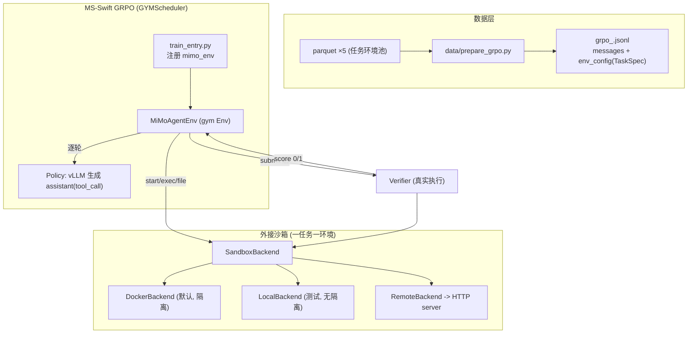
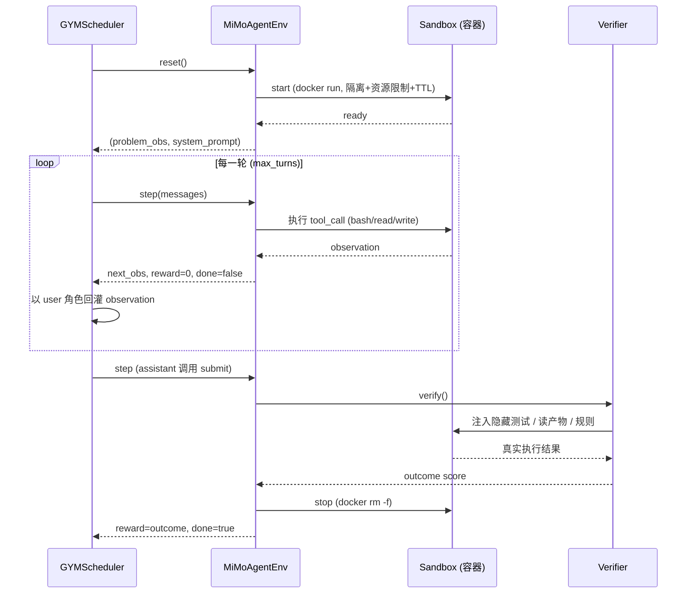

# MiMo Agent GRPO on MS-Swift

基于阿里 **MS-Swift** 的 **GRPO**，使用小米 **MiMo-V2.6** 开源的 **Agent 训练任务环境**，
通过**外接沙箱（Docker / HTTP 沙箱服务）+ verifier（真实执行打分）**，复刻小米在 GitHub
开源的 **VERL 交互式 Agent RL 训练流程**，并与之**逐步逻辑对齐**。

- 训练框架：[modelscope/ms-swift](https://github.com/modelscope/ms-swift)（本工程以 **v4.5.3** 源码为准）
- 数据：[XiaomiMiMo/MiMo-V2.6-RL-oss](https://huggingface.co/datasets/XiaomiMiMo/MiMo-V2.6-RL-oss)（Apache-2.0）
- 小米原生 RL：[XiaomiMiMo/verl](https://github.com/XiaomiMiMo/verl)（分支 `mimo-oss`）
- 沙箱/Agent harness：[XiaomiMiMo/mimoagent](https://github.com/XiaomiMiMo/mimoagent)

---

## 0. 三个必须先讲清的事实（联网核实，纠正常见误解）

1. **开源的不是“带轨迹的训练数据”，而是“Agent RL 任务环境池”。**
   5 个 parquet、共 **7,780 条任务**，parquet 总量仅约 **20MB**（不是 12GB）。仓库体积大是因为
   附带 4 万+ 环境文件（workspace 数据、SQLite 库、Python 工具脚本）。**parquet 里没有
   trajectory**：交互轨迹是训练时由 agent 在容器内多轮调用工具**动态产生**的。
2. **小米开源仓只包含第二阶段 RL（GRPO），不包含第一阶段 IL/SFT。**
   RL 直接从已蒸馏好的 [`MiMo-V2.6-Distill-Qwen-9B`](https://huggingface.co/XiaomiMiMo/MiMo-V2.6-Distill-Qwen-9B)
   起步；其“多教师在线蒸馏（IL）”代码未开源。本工程因此：
   - **主路径**：直接用蒸馏权重跑 GRPO（与小米完全一致）；
   - **可选 IL 预热**：提供“在沙箱里跑 agent → 保留 reward==1 的成功轨迹 → SFT”的等价实现
     （`data/collect_il_demo.py` + `data/prepare_sft.py` + `configs/sft.yaml`）。
3. **沙箱不是常驻服务，而是“一任务一容器”。** 命令经 `docker exec`（等价 `timeout N bash -lc`）
   执行，文件走 tar，用完即毁；镜像由每行数据的 `docker_image` 指定。本工程同时提供一个
   **可选的外接 HTTP 沙箱服务**（`sandbox/server.py`），便于远程/集中式部署。

| 领域 | 任务数 | verifier 类型 | 沙箱 |
|---|---|---|---|
| Code（SWE） | 2,698 | 隐藏测试可执行，二值 | 每任务独立镜像 |
| WebDev | 2,093 | 渲染截图 + 视觉评分（组级相对排序需 grader） | 共享镜像 |
| General | 989 | LLM-as-judge rubric | 共享镜像 |
| Cyber（ARVO） | 1,000 | sanitizer 崩溃规则匹配，二值 | 每任务独立镜像 |
| Music | 1,000 | ABC 记谱规则分 | **无沙箱** |

---

## 1. 架构与流程

### 1.1 本工程架构



### 1.2 交互式 RL 时序（与小米一致）



> **多轮的本质**（与小米相同）：不是 KV 连续续写，而是**逐轮独立 generate**——每轮把上一轮
> assistant(tool_call) 与 tool observation 一起塞进 messages，重新 prefill 再生成下一轮。

---

## 2. 与小米 VERL 流程的逻辑对齐对照表

| 环节 | 小米原生实现（verl `mimo-oss` / mimoagent） | 本工程（MS-Swift） | 是否对齐 |
|---|---|---|---|
| 算法 | GRPO，`adv_estimator=grpo` | `--rlhf_type grpo`（`advantage_estimator: grpo`） | ✅ |
| KL | **无 KL**（`use_kl_in_reward/loss=false`） | `beta: 0.0`（不建 ref、不做 KL） | ✅ |
| 优势归一 | 组内**只减均值、不除 std**（`norm_adv_by_std=false`） | `scale_rewards: none`（GRPO 恒做组内减均值，`none` 不除 std） | ✅ |
| 同组全同丢弃 | `filter_groups`（reward 全同整组丢） | Swift 组内 reward 全同→优势为 0（等价零梯度） | ✅（等价） |
| PPO clip | `clip_ratio=0.2` | `epsilon: 0.2` | ✅ |
| 学习率 | `1e-6` constant | `learning_rate: 1.0e-6`, `lr_scheduler_type: constant` | ✅ |
| 采样 | temp=1.0, top_p=0.95, top_k=20 | 同值 | ✅ |
| 分组大小 | N=16（生产） | `num_generations`（默认示例 8，注释说明可设 16） | ✅（可调） |
| 沙箱形态 | 一任务一 Pod/容器，k8s/docker exec | 一任务一容器（DockerBackend） | ✅ |
| 命令执行 | `timeout N bash -lc` → `{output,returncode,reason}` | 同（`docker exec ... timeout N bash -lc`） | ✅ |
| 文件传输 | tar 流 / docker cp | tar 流（docker）/ 直接写（local） | ✅ |
| 网络隔离 | 默认断网 + 反作弊域名黑洞 | `--network=none`（`spec.network=true` 才放开） | ✅（基础） |
| 资源限制 | Pod cpu/mem 配额 | `--memory/--cpus/--pids-limit` | ✅ |
| 隐藏测试 | 打分时才 `git apply test_patch` | `CodeVerifier.verify()` 内 apply（agent 期间无测试） | ✅ |
| Code reward | test_command exit 0 → 1.0（二值） | 同 | ✅ |
| Cyber reward | 崩溃函数+sanitizer+error_type 全等 | `CyberVerifier` 同规则（依赖 arvo 镜像内 server） | ✅（逻辑） |
| General reward | judge agent 逐条 rubric，B=均值，`w·S+(1−w)B` | `GeneralVerifier` 经 OpenAI 兼容 judge 同式 | ✅（逻辑） |
| Music reward | 18 特征 vs 人类分布（六组权重） | 结构性规则子集（同权重映射，留 `_feature_score` 钩子） | ⚠️ 子集 |
| WebDev reward | 截图 + 组级 8 轮成对相对排序 | 确定性检查 + `/grade` 钩子；组级排序留接口 | ⚠️ 部分 |
| 奖励发放位置 | 仅**末位 token 单点** outcome | 中间步 reward=0，最终步一次性 outcome（total_reward） | ✅ |
| 基建失败 | `is_infra`，不当 0 分 | step 返回 `is_infra=True`（应在组内剔除） | ✅ |
| 容器泄漏防护 | Pod TTL / 框架销毁 | `--rm` + 容器内 TTL 自毁 + Local atexit | ✅（加固） |
| IL/SFT | **未开源**（起点为蒸馏权重） | 可选：成功轨迹 SFT 等价实现 | ⚠️ 补充 |
| 工程加速 | Megatron TP/CP + SGLang FP8 + colocate_async | Swift vLLM colocate（算法无关） | 🔁 等价替换 |

---

## 3. 目录结构

```
mimo-agent-grpo-swift/
├── configs/                 # grpo_code / grpo_music / grpo_general / sft 配置（yaml）
├── data/
│   ├── download_dataset.py     # 下载 5 parquet
│   ├── prepare_grpo.py         # parquet -> GRPO jsonl（messages + env_config）
│   ├── prepare_sft.py          # rollout dump -> SFT jsonl（保留成功轨迹）
│   └── collect_il_demo.py      # 可选：跑 agent 采集成功轨迹
├── sandbox/
│   ├── base.py                 # SandboxBackend 抽象 + ExecResult + 工厂
│   ├── docker_backend.py       # 一任务一容器（默认，隔离）
│   ├── local_backend.py        # 临时目录（无隔离，仅测试）
│   ├── remote_backend.py       # HTTP 客户端
│   ├── server.py               # 外接 HTTP 沙箱服务（FastAPI）
│   ├── mcp_client.py           # general 域 MCP 工具客户端
│   ├── Dockerfile / docker-compose.yml / docker-entrypoint.sh
├── verifier/
│   ├── base.py                 # Verifier 抽象 + VerificationResult
│   ├── code_verifier.py        # 隐藏测试二值
│   ├── cyber_verifier.py       # sanitizer 崩溃规则
│   ├── general_verifier.py     # LLM rubric judge
│   ├── webdev_verifier.py      # 渲染/视觉（含 grader 钩子）
│   ├── music_verifier.py       # ABC 规则
│   └── llm_judge.py            # OpenAI 兼容判官
├── swift_agent/
│   ├── spec.py                 # TaskSpec（parquet/env_config 互转）
│   ├── tool_parser.py          # <tool_call> 文本协议 + 系统提示
│   ├── turn_executor.py        # 单轮工具执行 + finalize
│   ├── agent_runner.py         # 独立 episode（IL 采集 / smoke）
│   ├── mimo_env.py             # gym Env（注册 mimo_env）★训练集成
│   └── train_entry.py          # 训练入口（注册 + rlhf_main）
├── scripts/                   # prepare_data / start_sandbox / run_sft / run_grpo / smoke_test
├── tests/                      # 闭环 + 组件单测 + mock 样本
└── docs/INTERFACE.md           # 接口冻结规范
```

---

## 4. 安装

```bash
# 建议 Python>=3.10；先按 CUDA 安装匹配的 torch（略）
pip install -r requirements.txt
# GRPO rollout 强烈建议安装 vLLM（与 torch/CUDA 匹配）
pip install vllm

cp .env.example .env            # 按需填写（judge / sandbox 地址等）
```

> ms-swift 版本请确保 **>=4.5.3**（`python -c "import swift;print(swift.__version__)"`），
> 旧版本的多轮 gym 接口可能不同。

---

## 5. 数据下载与准备

```bash
# 方式一：一键脚本（默认全部领域，后端默认 docker）
bash scripts/prepare_data.sh

# 方式二：分步、可控
python -m data.download_dataset --domains code music
python -m data.prepare_grpo \
    --domains code music \
    --backend docker \
    --output-path data/outputs/grpo_train.jsonl
# 无 GPU/仅本机演示闭环时，后端用 local（无隔离，仅测试）：
python -m data.prepare_grpo --domains code music --backend local
```

产物：`data/outputs/grpo_<domain>.jsonl`，每行形如：

```json
{
  "messages": [{"role": "user", "content": "Implement fib(n) ..."}],
  "env_config": {
    "name": "mimo_env",
    "domain": "code", "dataset_type": "opensource-code",
    "docker_image": "format-code-task-001457:latest", "cwd": "/testbed",
    "problem_statement": "...", "test_command": "...", "test_patch": "...",
    "backend": "docker", "verifier_timeout_sec": 300.0
  }
}
```

> 字段映射基于**真实 parquet schema**（见 `swift_agent/spec.py` 与 `research/01_dataset_schema.md`），
> 对缺失字段做了健壮处理。

---

## 6. 沙箱

### 6.1 Docker（默认，生产/真实训练）
无需常驻服务：训练时每个任务自动 `docker run` 一个隔离容器（`--rm`、默认 `--network=none`、
`--memory/--cpus/--pids-limit`、TTL 自毁），结束 `docker rm -f`。请确保宿主机：

```bash
docker version          # daemon 可用
# 提前拉取任务镜像（小米提供）：
docker pull xiaomimimo/mimo-v2.6-rl-oss
```

### 6.2 外接 HTTP 沙箱服务（可选，远程/集中式）
```bash
# 真实环境用 docker 后端管理 per-task 容器
bash scripts/start_sandbox.sh
# 本机无 docker，仅演示服务链路时：
SANDBOX_BACKEND=local SANDBOX_PORT=8100 bash scripts/start_sandbox.sh
```
准备数据时指向该服务：`--backend remote --sandbox-url http://<host>:8100`。
端点：`POST /sessions`、`POST /sessions/{id}/exec`、`POST/GET /sessions/{id}/files`、
`DELETE /sessions/{id}`、`GET /healthz`（详见 `sandbox/server.py`）。

### 6.3 Local（无隔离，仅测试）
`--backend local` 会在临时目录直接执行命令，**严禁用于不可信模型/生产**（启动有显著警告，
含路径穿越防护与 atexit 清理）。

---

## 7. 训练运行

### 7.1 主路径：GRPO（与小米一致，从蒸馏权重起步）
```bash
# 单进程（先小规模跑通）
bash scripts/run_grpo.sh code
# 多卡
NPROC_PER_NODE=8 bash scripts/run_grpo.sh code
# 其它域
bash scripts/run_grpo.sh music
bash scripts/run_grpo.sh general      # 需配置 JUDGE_*
```
等价直接命令：
```bash
python swift_agent/train_entry.py configs/grpo_code.yaml
```

### 7.2 可选：IL/SFT 预热（小米未开源，本工程补充的等价路径）
```bash
# 1) 用一个 OpenAI 兼容 policy 在沙箱里采集轨迹（成功/失败都记录）
python -m data.collect_il_demo \
    --input data/outputs/grpo_code.jsonl \
    --max-tasks 200 --max-turns 20 \
    --policy-base-url $OPENAI_BASE_URL --policy-api-key $OPENAI_API_KEY --policy-model $MODEL_NAME
# 2) 仅保留 reward==1 的成功轨迹 -> SFT 数据
python -m data.prepare_sft --input data/outputs/rollout_dump.jsonl
# 3) SFT
bash scripts/run_sft.sh
# 之后把 configs/grpo_code.yaml 的 model 改为 runs/sft 产出的 checkpoint 再跑 GRPO。
```

### 7.3 预期产物
- `runs/grpo_<domain>/`：checkpoint、`args.json`、（可选）`completions.jsonl`。
- 训练日志：reward 均值、组内通过率、num_turns、tool_error、is_infra 计数等。

---

## 8. 静态验证与闭环测试

```bash
bash scripts/smoke_test.sh
# 或：
python -m py_compile $(find . -name "*.py" -not -path "*/research/*")
python -m pytest -q
```

**本机已实际执行的验证（2026-10-08）：**
- ✅ 全部 Python 文件 `py_compile` 通过。
- ✅ `prepare_grpo` 对真实 parquet（music 全量 + 其余各域取样）跑通，`env_config.name=='mimo_env'`、
  `TaskSpec.from_env_config` 可逆、domain 正确。
- ✅ `prepare_sft` 成功/失败/基建三类轨迹过滤正确。
- ✅ LocalBackend：命令执行、读写、超时（returncode 124）、路径穿越拦截均实测通过。
- ✅ **端到端闭环**：mock 模型输出 → 沙箱真实执行 → verifier 打分：
  Code 正确=1/错误=0；Music 合法=高分/非法=0。
- 测试结果：**15 passed**；gym 适配用例在安装 ms-swift 后追加运行（见下）。

**因资源/环境未实际运行（如实说明，未谎称通过）：**
- ❌ 未跑真实 **GPU GRPO 训练**（本机无 GPU/无多卡、无 vLLM）；配置参数名均按 4.5.3 源码核实。
- ❌ **DockerBackend 未实跑**（本机无 docker daemon）；其命令拼装、隔离/TTL 逻辑经静态核对。
- ⚠️ Cyber 依赖每任务镜像内的 `server_arvo.py`、WebDev 组级相对排序依赖外部 grader 服务、
  Music 高级 18 特征依赖 `abc2midi` 与人类参考分布：这些外部依赖缺失时按文档降级，逻辑已对齐。

---

## 9. 故障排查

| 现象 | 原因/处理 |
|---|---|
| `No module named swift` | `pip install "ms-swift>=4.5.3"`；训练必须安装。 |
| `docker daemon unavailable` | 启动 Docker；或改用 `--backend local`（仅测试）/`remote`。 |
| code 任务大量 `is_infra` | 多为镜像基线/补丁问题：确认镜像内是 git 仓库、test_patch 可 `git apply`。 |
| General 直接 `is_infra` | 未配置 judge：设置 `JUDGE_BASE_URL/JUDGE_API_KEY/JUDGE_MODEL`。 |
| 模型一直不调用工具 | 系统提示要求 `<tool_call>`；step 会回灌“请发起工具调用”的提示。 |
| 容器残留 | 已加 `--rm`+TTL；必要时 `docker ps -q --filter "name=mimo-" \| xargs -r docker rm -f`。 |
| `num_generations` 整除报错 | 让每批样本数能被 num_generations 整除；调小 per_device/grad accum。 |
| 下载 HF 慢 | 设置 `HF_ENDPOINT=https://hf-mirror.com`。 |

---

## 10. 关键来源（可追溯）

- MS-Swift：https://github.com/modelscope/ms-swift （tag v4.5.3）
  - GRPO 参数：`swift/arguments/rlhf_args.py`、`swift/rlhf_trainers/args_mixin.py`
  - gym 沙箱：`swift/rollout/gym_env.py`、`swift/rollout/multi_turn.py`、`swift/rollout/agent_loop.py`
  - reward 调用：`swift/rl_core/grpo_algorithm.py`、`swift/rewards/orm.py`
- 小米 VERL：https://github.com/XiaomiMiMo/verl（branch `mimo-oss`）
  - 主配置 `recipes/code/config/train.yaml`；Code runner `recipes/code/mimoagent_runner.py`
  - ARVO `recipes/arvo/agent_loop.py`；塑形 `verl/trainer/ppo/arvo_penalties.py`
- 小米 harness：https://github.com/XiaomiMiMo/mimoagent
  - Code 打分 `src/mimoagent/environments/datasets/opensource_code.py`
  - rubric judge `src/mimoagent/environments/rubric_judge.py`
  - docker/k8s 后端 `src/mimoagent/environments/docker.py` / `kubernetes.py`
- 数据集：https://huggingface.co/datasets/XiaomiMiMo/MiMo-V2.6-RL-oss
- 起点模型：https://huggingface.co/XiaomiMiMo/MiMo-V2.6-Distill-Qwen-9B
- 镜像：https://hub.docker.com/r/xiaomimimo/mimo-v2.6-rl-oss
