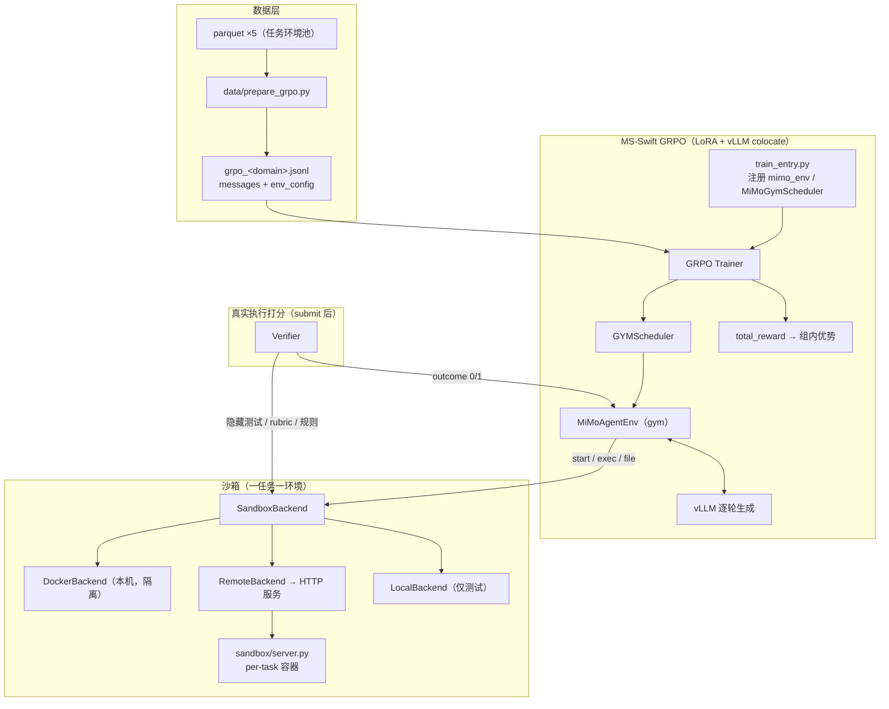
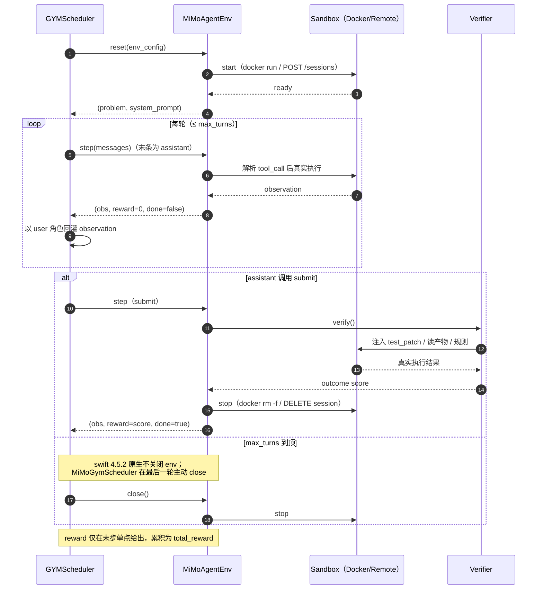
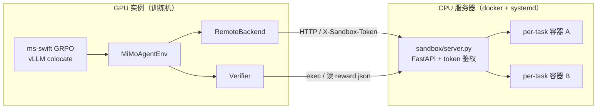

# MiMo Agent GRPO on MS-Swift

用 **MS-Swift** 的 GRPO 复刻小米 **MiMo-V2.6** 开源的交互式 Agent RL 训练流程：
**多轮工具调用 + 外接沙箱 + 真实执行 verifier**，算法与超参逐项对齐
[XiaomiMiMo/verl `mimo-oss`](https://github.com/XiaomiMiMo/verl) 分支。

| 资源 | 地址 |
|---|---|
| 训练框架 | [modelscope/ms-swift](https://github.com/modelscope/ms-swift)（**v4.5.2**，已实测） |
| 训练数据 | [XiaomiMiMo/MiMo-V2.6-RL-oss](https://huggingface.co/datasets/XiaomiMiMo/MiMo-V2.6-RL-oss)（Apache-2.0） |
| 起点模型 | [MiMo-V2.6-Distill-Qwen-9B](https://huggingface.co/XiaomiMiMo/MiMo-V2.6-Distill-Qwen-9B) |
| 任务镜像 | `xiaomimimo/mimo-v2.6-rl-oss`（Docker Hub，单仓多 tag） |
| 原生流程 | [XiaomiMiMo/verl](https://github.com/XiaomiMiMo/verl/tree/mimo-oss) · [mimoagent](https://github.com/XiaomiMiMo/mimoagent) |

---

## 0. 关键事实

1. **开源的是「任务环境池」，不是带轨迹的数据。** 5 个 parquet 共 **7,780 条任务**、仅约 20MB；
   轨迹在训练时由 agent 在容器内多轮工具调用**动态产生**。仓库体积主要来自 4 万+ 环境文件。
2. **小米只开源第二阶段 RL（GRPO），不含 IL/SFT。** RL 直接从蒸馏权重起步；本工程另外提供可选的
   「成功轨迹 → SFT」等价 IL 路径（`data/collect_il_demo.py` + `data/prepare_sft.py`）。
3. **沙箱是一任务一容器。** 命令经 `docker exec`（等价 `timeout N bash -lc`），文件走 tar，用完即毁；
   镜像由数据的 `docker_image` 指定。本工程提供本机 Docker 与**外接 HTTP 沙箱服务**（GPU 实例 +
   远程 CPU 服务器）两种形态。

| 领域 | 任务数 | verifier | 沙箱形态 |
|---|---|---|---|
| Code（SWE） | 2,698 | 隐藏测试，exit 0 → 1.0 | 每任务独立镜像（2~12GB/个） |
| WebDev | 2,093 | 确定性检查 + 视觉评分钩子 | 1 个共享镜像 |
| General | 989 | 官方 `run_verify.py`（rubric/judge） | 共享镜像 + MCP 工具 |
| Cyber（ARVO） | 1,000 | sanitizer 崩溃规则，二值 | 每任务独立镜像 |
| Music | 1,000 | ABC 记谱规则分 | **无沙箱** |

---

## 1. 架构与流程

### 1.1 架构总览



### 1.2 单轨迹时序（与小米一致）



**多轮机制**：不是 KV 连续续写，而是每轮把上一轮 assistant(tool_call) 与 tool observation
一起回灌 messages、重新 prefill 生成；中间步 reward=0，仅最终 `submit` 后由 verifier
一次性给出 outcome（累加进 `total_reward`）。

**工具协议**：MiMo 蒸馏模型原生输出 Qwen XML 格式
（`<tool_call><function=bash><parameter=command>…</parameter></function></tool_call>`），
`swift_agent/tool_parser.py` 同时兼容该格式与 JSON 格式。

---

## 2. 与小米 VERL 的对齐

| 环节 | 小米 `mimo-oss` | 本工程 | 状态 |
|---|---|---|---|
| 算法 / 优势 | `adv_estimator=grpo`，组内减均值不除 std | `grpo` + `scale_rewards: none` | ✅ |
| KL / clip | 无 KL；clip 0.2 | `beta: 0.0`；`epsilon: 0.2` | ✅ |
| 采样 | temp 1.0 / top_p 0.95 / top_k 20 | 同 | ✅ |
| 学习率 | 1e-6 constant | 同 | ✅ |
| 分组过滤 | `filter_groups` 整组丢 | 全同 reward → 优势 0（等价零梯度） | ✅ 等价 |
| 沙箱 | 一任务一 Pod，exec + tar | 一任务一容器，exec + tar；支持远程 HTTP 服务 | ✅ |
| 镜像 | 每任务镜像 | `image-mapping.jsonl` 映射官方 tag，缺失自动 pull | ✅ |
| 打分 | 阶段末真实执行 | verifier 在 `submit` 后真实执行（agent 期间无测试） | ✅ |
| reward 位置 | 末位单点 outcome | 中间 0 + 末步 outcome | ✅ |
| 基建失败 | `is_infra` 不记 0 分 | `is_infra=True`（组内剔除） | ✅ |
| General | 双容器（main+sidecar）+ MCP | 单容器近似 + 官方 verify 优先 | ✅ 近似 |
| Music / WebDev | 18 特征 / 组级视觉排序 | 规则子集 / 确定性检查 + 钩子 | ⚠️ 部分 |
| 训练方式 | 全参 + Megatron/SGLang | **LoRA** + vLLM colocate | 🔁 等价替换 |

---

## 3. 目录结构

```
mimo-agent-grpo-swift/
├── configs/                    # grpo_code / grpo_music / grpo_general / grpo_code_smoke / sft（yaml）
├── data/
│   ├── download_dataset.py     # 下载 5 个 parquet（默认 ModelScope，可切 HF）
│   ├── image_mapping.py        # dataset_image -> dockerhub tag 映射（image-mapping.jsonl）
│   ├── download_general_envs.py # 下载 general/envs/<task>/ 任务环境目录（925 个）
│   ├── prepare_grpo.py         # parquet -> GRPO jsonl（messages + env_config）
│   ├── gen_image_list.py       # grpo jsonl -> 镜像预拉取清单
│   ├── prepare_sft.py          # rollout dump -> SFT jsonl（保留成功轨迹）
│   └── collect_il_demo.py      # 可选：跑 agent 采集成功轨迹
├── sandbox/
│   ├── base.py                 # SandboxBackend 抽象 + ExecResult + 后端工厂
│   ├── docker_backend.py       # 一任务一容器（默认），镜像解析/自动 pull/任务级资源
│   ├── local_backend.py        # 临时目录（无隔离，仅测试），容器路径映射模拟
│   ├── remote_backend.py       # HTTP 客户端（鉴权/长超时/upload_dir）
│   ├── server.py               # 外接 HTTP 沙箱服务（FastAPI，token/并发闸门/空闲回收）
│   ├── general_env_setup.py    # general 域 env_task_dir 装配（manifest uploads / MCP / rubrics）
│   ├── mcp_client.py           # general 域 MCP 工具客户端
│   └── Dockerfile / docker-compose.yml / docker-entrypoint.sh
├── verifier/
│   ├── base.py                 # Verifier 抽象 + VerificationResult
│   ├── code_verifier.py        # 隐藏测试二值（reset -> git apply -> test_command）
│   ├── cyber_verifier.py       # sanitizer 崩溃规则
│   ├── general_verifier.py     # 官方 run_verify.py 优先 + LLM rubric 兜底
│   ├── webdev_verifier.py      # 渲染/视觉（含 grader 钩子）
│   ├── music_verifier.py       # ABC 记谱规则
│   └── llm_judge.py            # OpenAI 兼容判官
├── swift_agent/
│   ├── spec.py                 # TaskSpec（parquet/env_config 互转）
│   ├── tool_parser.py          # Qwen XML + JSON 双格式工具协议 + 系统提示
│   ├── turn_executor.py        # 单轮工具执行 + finalize
│   ├── agent_runner.py         # 独立 episode（IL 采集 / smoke）
│   ├── mimo_env.py             # gym Env + MiMoGymScheduler（注册 mimo_env）★训练集成
│   └── train_entry.py          # 训练入口（注册 env -> rlhf_main）
├── scripts/                    # prepare_data / deploy_sandbox_server / prefetch_images /
│                               # run_grpo / run_sft / start_sandbox / smoke_test
├── tests/                      # 41 个测试（闭环 + 组件单测 + mock 样本）
├── docs/INTERFACE.md           # 接口冻结规范
├── .env.example                # 环境变量样例（需手动 source）
├── requirements.txt
└── README.md
```

---

## 4. 安装

要求：Python ≥ 3.10；GPU 训练需 CUDA 与 vLLM 匹配；沙箱服务器需 docker。

```bash
conda create -n mimo-grpo python=3.11 -y && conda activate mimo-grpo

# torch / vllm 请按本机 CUDA 版本安装（示例：cu130）
pip install torch --index-url https://download.pytorch.org/whl/cu130
pip install vllm
pip install -r requirements.txt          # ms-swift>=4.5.2 等

python -c "import swift; print(swift.__version__)"   # 应 >= 4.5.2
```

环境变量：`cp .env.example .env` 后按需填写。**`.env` 不会被自动加载**，使用前需注入：

```bash
set -a; source .env; set +a
```

> 若 GPU 为 Blackwell（sm120），`run_grpo.sh` / `run_sft.sh` 已内置
> `VLLM_USE_FLASHINFER_SAMPLER=0`（绕过 flashinfer 0.6.12 无 sm120 cubin 的缺陷）；
> 直接 `python swift_agent/train_entry.py` 启动时需自行 export。

---

## 5. 模型与数据准备

### 5.1 下载模型（国内推荐 ModelScope）

```bash
pip install modelscope                     # ms-swift 环境通常已自带
modelscope download --model XiaomiMiMo/MiMo-V2.6-Distill-Qwen-9B \
    --local_dir /root/autodl-tmp/models/MiMo-V2.6-Distill-Qwen-9B
```

HF 备选：`export HF_ENDPOINT=https://hf-mirror.com && huggingface-cli download XiaomiMiMo/MiMo-V2.6-Distill-Qwen-9B --local-dir <同上>`（较慢）。

**修改配置中的模型路径**：所有 `configs/*.yaml` 的 `model:` 当前为
`/root/autodl-tmp/models/MiMo-V2.6-Distill-Qwen-9B`，与你的实际路径不一致时请批量替换：

```bash
sed -i 's#^model: .*#model: /your/path/MiMo-V2.6-Distill-Qwen-9B#' configs/*.yaml
```

### 5.2 下载数据与镜像映射

```bash
# 一键（默认全部域、docker 后端）
bash scripts/prepare_data.sh
#   读取环境变量：SANDBOX_BACKEND（docker|remote|local）、SANDBOX_URL、
#   JUDGE_BASE_URL / JUDGE_MODEL。例如远程沙箱：
#   SANDBOX_BACKEND=remote SANDBOX_URL=http://<IP>:8100 bash scripts/prepare_data.sh code

# 或分步
python -m data.download_dataset --domains code music     # 默认 ModelScope 直链
python -m data.download_dataset --channel hf --domains code   # 改走 HF/HF-mirror
python -m data.image_mapping                             # image-mapping.jsonl（3764 条）
python -m data.prepare_grpo --domains code music --limit 20 \
    --backend docker --output-path data/outputs/grpo_train.jsonl
```

- `--limit N`：每域随机取样 N 条（`--seed` 控制），适合先跑通再扩量。
- `--backend docker|remote|local` 写入每行 env_config；远程部署用
  `--backend remote --sandbox-url http://<IP>:8100`。
- 产物：`data/outputs/grpo_<domain>.jsonl`（含 `messages` 与完整 `env_config`）。
- 下载通道：`MS_CHANNEL=modelscope|hf`（默认 modelscope）。

**镜像映射（关键）**：parquet 的 `docker_image` 是本地别名
（如 `format-code-task-001457:latest`），真实镜像为
`docker.io/xiaomimimo/mimo-v2.6-rl-oss:format-code-task-001457`（**tag 名不同**）。
`prepare_grpo` 按映射表写入 `env_config.dockerhub_image`，运行时优先使用并自动 pull。

**general 域**需额外下载任务环境目录（rubric / MCP 工具 / workspace 文件）：

```bash
python -m data.download_general_envs                       # 全量 925 个（体积大）
python -m data.download_general_envs \
    --from-jsonl data/outputs/grpo_general.jsonl --limit 50 # 仅取样任务
python -m data.download_general_envs --tasks s3k_0000_accounting_audit_tax_en_t1_rl_008
```

未下载 env_task_dir 的行会被 `prepare_grpo` 跳过并打印统计。

---

## 6. 沙箱

### 6.1 本机 Docker

训练进程直接 `docker run` 每任务容器（`--rm`、默认 `--network=none`、
`--memory/--cpus/--pids-limit`、容器内 TTL 自毁），无需常驻服务。

```bash
docker version    # 确认 daemon 可用
```

镜像本地缺失时自动 pull（`SANDBOX_DOCKER_PULL_TIMEOUT`，默认 1800s，
断流自动重试 `SANDBOX_DOCKER_PULL_RETRIES=2`）。general 域 parquet 携带的
`cpus/memory_mb` 会覆盖容器默认资源。

### 6.2 外接 HTTP 沙箱（GPU 实例 + 远程 CPU 服务器）★推荐

适用于 AutoDL 等**无法 docker-in-docker** 的 GPU 实例：GPU 侧只跑训练与 vLLM 生成，
所有容器在远程服务器的 docker 中执行，二者经 HTTP 通信。



> 每轮工具调用、镜像拉取、容器执行与最终打分全部经 HTTP 落到服务器侧；
> GPU 侧不接触 docker。

**服务器侧**（已装 docker，clone 本工程）：

```bash
bash scripts/deploy_sandbox_server.sh
# 自动完成：轻量 venv（无 torch）→ /etc/mimo-sandbox.env（随机 token）→
# systemd 服务（自启/崩溃拉起）→ 健康检查；输出 SANDBOX_TOKEN。
# 可选环境变量：SANDBOX_PORT=8100 MAX_SESSIONS=2 SANDBOX_TOKEN=xxx
#               DOCKER_MIRRORS="https://<id>.mirror.aliyuncs.com"
```

- **安全组**：放行服务端口 TCP（默认 8100），建议仅白名单 GPU 实例出口 IP。
- **镜像加速**：公共加速器对 `xiaomimimo` 仓不可靠（白名单拒绝/层损坏）。实测
  `docker.1panel.live` 可用；阿里云 ECS 建议用控制台「容器镜像服务 → 镜像加速器」的专属地址。
- **并发上限**：`SANDBOX_MAX_CONCURRENT_SESSIONS` 必须 **≥ 训练每批并发环境数 =
  `per_device_train_batch_size × gradient_accumulation_steps`**（且该值需能被
  `num_generations` 整除）。GYMScheduler 会先并发创建整批环境再开始生成，上限不足会
  卡在 `on_trajectory_start`。**2核4G 实测建议 2**。

**GPU 侧**：

```bash
export SANDBOX_URL=http://<服务器IP>:8100
export SANDBOX_TOKEN=<部署输出的 token>

python -m data.prepare_grpo --domains code --limit 20 \
    --backend remote --sandbox-url $SANDBOX_URL
bash scripts/run_grpo.sh code
```

**镜像预拉取**（强烈建议：code 镜像 2~12GB，会话内同步 pull 极慢且占磁盘）：

```bash
# GPU 实例：按取样数据生成清单并传给服务器
python -m data.gen_image_list data/outputs/grpo_code.jsonl -o code20.list
scp code20.list user@<server>:~/

# 服务器：并发 2、失败重试 3 次、断点续传
bash scripts/prefetch_images.sh ~/code20.list      # PARALLEL=2 RETRY=3 可调
df -h / && sudo docker system df                   # 注意磁盘余量
```

其他要点：

- **鉴权**：服务器设 `SANDBOX_TOKEN` 后所有业务端点校验 `X-Sandbox-Token`；
  token 仅经环境变量传递，不写入训练数据。`GET /healthz` 免鉴权。
- **会话回收**：swift 4.5.2 在轨迹 `max_turns` 到顶时不调用 `env.close()`。本工程用
  `MiMoGymScheduler` 在最后一轮主动关闭；服务器另有 `SANDBOX_SESSION_IDLE_TTL`
  （默认 900s）空闲回收与 `SANDBOX_CREATE_WAIT`（默认 600s）有界排队兜底。
- **端点**：`/sessions`、`/sessions/{id}/exec`、`/files`、`/upload_dir`、
  `DELETE /sessions/{id}`（OpenAPI 见服务端 `/docs`）。general 域 env_task_dir
  由 GPU 侧打包经 `/upload_dir` 传入容器。

### 6.3 Local（无隔离，仅测试）

`--backend local` 在临时目录直接执行命令，含路径穿越防护与 atexit 清理，
**严禁用于不可信模型或生产**。

---

## 7. 训练

### 7.1 GRPO（LoRA，主路径）

所有配置统一 LoRA：`tuner_type: lora, lora_rank: 8, lora_alpha: 32,
target_modules: all-linear, lora_dropout: 0.05`；GRPO 学习率沿用小米 1e-6 constant。
`model_type: qwen3_5` 与 `template: qwen3_5` 为**必填消歧项**（否则 swift 自动匹配会撞车）。

```bash
# 单卡
bash scripts/run_grpo.sh code
# 多卡（torchrun）
NPROC_PER_NODE=8 bash scripts/run_grpo.sh code

# 小服务器 / 远程沙箱冒烟（batch1 × grad2 × N2）
bash scripts/run_grpo.sh code_smoke

# 其它域
bash scripts/run_grpo.sh music      # 无沙箱，最快验证闭环
bash scripts/run_grpo.sh general    # 需 JUDGE_*（或官方 verify 容器内可用）
```

等价直接命令：`python swift_agent/train_entry.py configs/grpo_code.yaml`
（`train_entry` 先注册 mimo_env / MiMoGymScheduler，再进入 `rlhf_main`）。

关键参数（`configs/grpo_code.yaml` 可调）：

| 参数 | 说明 |
|---|---|
| `num_generations` | 组大小（小米生产 16；单卡建议 8，小服务器 2） |
| `max_turns` | 单轨迹最大轮次（code 默认 20；冒烟 8） |
| `vllm_gpu_memory_utilization` | colocate 显存占比（95GB 卡可用 0.35~0.5） |
| `vllm_enable_lora` | **LoRA 训练必须 true**（否则 rollout 用基础权重，off-policy） |
| `per_device_train_batch_size × gradient_accumulation_steps` | = 每批并发环境数，须 ≤ 沙箱并发上限 |
| `max_completion_length` / `max_length` | 单轮生成长度 / 总上下文 |

产物：`runs/grpo_<domain>_lora/v<N>-<timestamp>/`，含 LoRA adapter、`args.json`、
`logging.jsonl`、`completions.jsonl`。合并权重导出：

```bash
swift export --adapters runs/grpo_code_lora/v<N>-*/checkpoint-<step> \
    --merge_lora true --output_dir runs/merged
```

### 7.2 可选：IL/SFT 预热

```bash
# 1) 用 OpenAI 兼容 policy 在沙箱采集轨迹（成功/失败均记录）
python -m data.collect_il_demo \
    --input data/outputs/grpo_code.jsonl \
    --output data/outputs/rollout_dump.jsonl \
    --max-tasks 200 --max-turns 20 --concurrency 4 \
    --policy-base-url $OPENAI_BASE_URL --policy-api-key $OPENAI_API_KEY \
    --policy-model $MODEL_NAME

# 2) 仅保留 reward==1 的轨迹 -> SFT 数据
python -m data.prepare_sft --input data/outputs/rollout_dump.jsonl \
    --reward-threshold 1.0 --output data/outputs/sft.jsonl

# 3) SFT（configs/sft.yaml 同为 LoRA）
bash scripts/run_sft.sh
```

之后把 GRPO 配置的 `model:` 改为 SFT 产出的 checkpoint 再训练。

---

## 8. 自测与验证

```bash
bash scripts/smoke_test.sh     # py_compile 全量 + pytest
# 或
python -m py_compile $(find . -name "*.py")
python -m pytest -q            # 41 passed
```

**已实测**（2026-10-18，单卡 RTX PRO 6000 96GB + 阿里云 2核4G 沙箱服务器）：

- ✅ `prepare_grpo` 全量 7,780 行跑通（6,855 行产出，general 925 行按设计跳过），
  `dockerhub_image` 注入率 100%；`image-mapping.jsonl` 3,764 条映射正确。
- ✅ music 域 GRPO+LoRA 完整闭环：4/4 steps，reward=0.85，loss/grad 正常。
- ✅ code 域多轮沙箱闭环：`grpo_code_smoke` 2/2 steps（~42s/step），真实容器
  exec、checkpoint 落盘、会话零泄漏；模型按原生 XML 格式操作容器。
- ✅ general 域真实任务装配：27 文件上传、6 条 rubric、4 个 MCP server 注入。
- ✅ 远程沙箱全链路：鉴权、exec、文件读写、`upload_dir`、并发闸门、空闲回收。

**未验证/已知限制（如实说明）**：

- ❌ 未跑长程/多卡训练，未验证收敛效果；smoke 只证明闭环正确。
- ⚠️ general 官方 `run_verify.py` 与 MCP 依赖镜像内环境，仅 docker/remote 可用；
  local 后端降级为 LLM judge。
- ⚠️ code 镜像 2~12GB/个，小磁盘服务器只能缓存少量任务；大规模训练需扩容磁盘。

---

## 9. 故障排查

| 现象 | 原因与处理 |
|---|---|
| `FlashInfer requires GPUs with sm75 or higher` / `SM 12.x requires CUDA >= 12.9` | Blackwell(sm120) 上 flashinfer 0.6.12 无 sm120 cubin。`export VLLM_USE_FLASHINFER_SAMPLER=0`（脚本已内置）。 |
| `docker pull failed`（超时/断流/`magic number mismatch`） | 加速器不可靠。配置阿里云专属加速器或 `docker.1panel.live`；预拉取 `scripts/prefetch_images.sh`。 |
| 训练停在 `Train 0/N`、沙箱 `sessions` 不增长 | ①镜像在 cold pull（看服务器 `docker pull`）；②并发上限 < batch×grad_accum（看线程栈卡在 `on_trajectory_start`）。 |
| CUDA OOM（第二个 micro-batch） | 降低 `vllm_gpu_memory_utilization`（0.5→0.35）、`max_length` 或 batch。 |
| `generation_batch_size (N) must be evenly divisible by num_generations` | 令 `per_device_train_batch_size × gradient_accumulation_steps` 能被 `num_generations` 整除。 |
| 模型一直不调用工具 | 检查输出是否为 Qwen XML 格式（已支持）；确认系统提示未被覆盖；`step` 会回灌纠错提示。 |
| `env_task_dir not found locally` | `python -m data.download_general_envs --tasks <id>`（或 `--from-jsonl`）。 |
| General 直接 `is_infra` | 未配置 judge：设 `JUDGE_BASE_URL/JUDGE_API_KEY/JUDGE_MODEL`；或官方 verify 不可用。 |
| code 任务大量 `is_infra` | 镜像内需为 git 仓库且 `test_patch` 可 `git apply`；检查 `test_command` 绝对路径。 |
| `No module named swift` | `pip install "ms-swift>=4.5.2"`。 |
| 容器残留 | 已内置 `--rm` + TTL；`docker ps -q --filter name=mimo- \| xargs -r docker rm -f`。 |
| 下载慢 | HF 设 `HF_ENDPOINT=https://hf-mirror.com`；模型/数据优先 ModelScope。 |

---

## 10. 参考来源（可追溯）

- MS-Swift：https://github.com/modelscope/ms-swift（tag `v4.5.2`，已实测）
  - GRPO 参数：`swift/arguments/rlhf_args.py`、`swift/rlhf_trainers/args_mixin.py`
  - gym 沙箱：`swift/rollout/gym_env.py`、`swift/rollout/multi_turn.py`、`swift/rollout/agent_loop.py`
  - reward 调用：`swift/rl_core/grpo_algorithm.py`、`swift/rewards/orm.py`
  - LoRA / vLLM 同步：`swift/tuners/base.py`、`swift/rlhf_trainers/{rollout_mixin,vllm_client}.py`
- 小米 VERL：https://github.com/XiaomiMiMo/verl（branch `mimo-oss`）
  - Code 主配置 `recipes/code/config/train.yaml`；Code runner `recipes/code/mimoagent_runner.py`
  - General `recipes/general/agent_loop.py`、`recipes/general/env_actor.py`
  - ARVO `recipes/arvo/agent_loop.py`；塑形 `verl/trainer/ppo/arvo_penalties.py`
- 小米 harness（mimoagent）：https://github.com/XiaomiMiMo/mimoagent（branch `mimo-oss`）
  - Code 打分 `src/mimoagent/environments/datasets/opensource_code.py`
  - rubric judge `src/mimoagent/environments/rubric_judge.py`
  - docker/k8s 后端 `src/mimoagent/environments/docker.py` / `kubernetes.py`
- 数据集：https://huggingface.co/datasets/XiaomiMiMo/MiMo-V2.6-RL-oss
  （ModelScope 官方同步仓：https://modelscope.cn/datasets/XiaomiMiMo/MiMo-V2.6-RL-oss）
- 起点模型：https://huggingface.co/XiaomiMiMo/MiMo-V2.6-Distill-Qwen-9B
  （ModelScope：https://modelscope.cn/models/XiaomiMiMo/MiMo-V2.6-Distill-Qwen-9B）
- 任务镜像：https://hub.docker.com/r/xiaomimimo/mimo-v2.6-rl-oss
- 本工程接口契约：`docs/INTERFACE.md`
